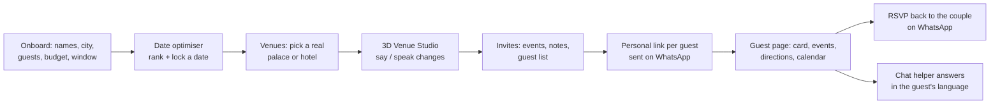
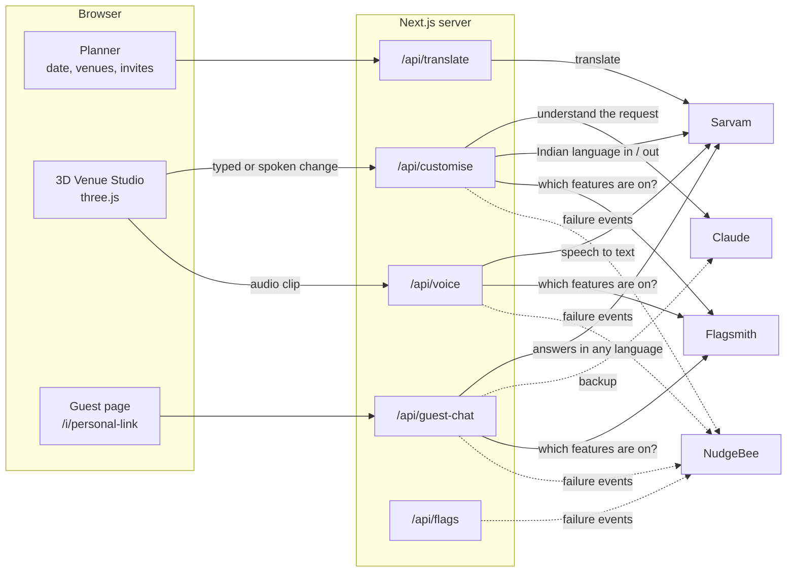
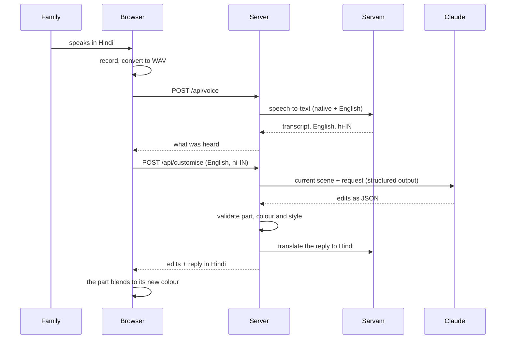
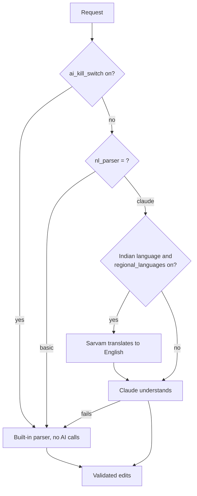
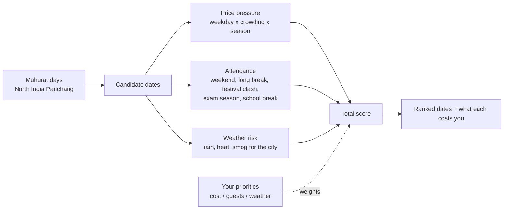

# Shaadi OS

**Plan the wedding, not the chaos.** Pick the right date, design the venue in 3D by *saying* what you want in any Indian language, and send every guest a personal invitation page with a helper that answers their questions.

> Built in one day for **Festive Hacks x WeAreDevelopers India** (Bengaluru, 25 Nov 2026). Theme: wedding logistics. Uses **Flagsmith**, **Sarvam AI** and **NudgeBee**.

---

## The problem

An Indian wedding is the densest festive occasion there is: about **326 guests and 10 vendors** on average, run on WhatsApp groups and spreadsheets. Two decisions start everything, and both are made on gut feel:

1. **Which date?** The Pandit gives three muhurats, the family picks the Saturday, and the venue and everyone's travel get more expensive for it.
2. **What will it look like?** Decor is described in words and Pinterest boards, then the day brings surprises.

And then 300 people need to be told, in their own language, where to be and when.

## What it does

| | What | How it helps |
|---|---|---|
| **1. Date optimiser** | Ranks auspicious dates in your window | Shows price pressure, whether guests can actually come, and typical weather, and what *moving* your favourite date is worth |
| **2. Venue Studio** | A full-screen 3D venue you walk around and restyle | Say it, type it or speak it ("फूलों को गेंदे के रंग का करो") and the right part changes; add a fountain, flower swing, diyas, chandeliers; swap designs |
| **3. Guest invitations** | A personal link per guest, sent on WhatsApp | A beautiful card, every event, RSVP, directions, and a chat helper in the guest's language |

## The journey



## Architecture



Everything is **deterministic where it can be** (date scoring, the fallback parser, validation of every AI edit) and uses an LLM only for the fuzzy part.

## Speak in your own language



## Flagsmith decides who answers



## How a date is scored



---

## The three sponsor tools, and exactly how each is used

| Tool | Where | What it does |
|---|---|---|
| **Flagsmith** | `lib/flags.ts`, `app/api/flags/route.ts`, `lib/useFlags.ts` | Per-wedding flags (identity = the wedding, traits = city and tradition, so segments and percentage rollouts work). `nl_parser` (remote config `claude` or `basic`) picks who understands requests. `ai_kill_switch` turns off Claude and Sarvam instantly. `studio_addons`, `voice_input`, `regional_languages` show or hide features. The studio re-reads flags every 10 s and shows a live "Flagsmith live" chip, so flipping a flag in the dashboard changes the running app with no redeploy. If Flagsmith is down, safe defaults apply and the failure is reported. |
| **Sarvam AI** | `lib/sarvam.ts`, `app/api/voice`, `app/api/translate`, `app/api/customise`, `app/api/guest-chat` | Speech-to-text (`saaras:v4`, language auto-detected) for voice in any Indian language, run twice in parallel (native text + English). `mayura:v1` translates typed Indian-language requests to English; `sarvam-translate:v1` translates replies and the WhatsApp invitation message into the family's or guest's language; `sarvam-105b-conversations` powers the guest chat helper (Claude is the backup). |
| **NudgeBee** | `lib/nudgebee.ts` | Reports the app's own operational failures (Claude or Sarvam failing, Flagsmith unreachable, voice pipeline failing) to NudgeBee's Event Webhook so incidents can be triaged. See the note below. |

**Honest note on NudgeBee.** NudgeBee is an AI-SRE platform built around Kubernetes. This app is a Next.js app, not a Kubernetes workload, so NudgeBee cannot monitor it natively. What is implemented is the event feed into NudgeBee's generic webhook. The payload shape in `lib/nudgebee.ts` follows NudgeBee's documented generic format as far as we could confirm; if your workspace expects different field names, edit `toPayload` there. We were also given NudgeBee's forager agent installer, but it is a Linux systemd installer and we develop on a Mac, so it is not installed. To see NudgeBee triage a live incident you would also run its agent on a cluster or Linux host.

---

## Run it

```bash
npm install
cp .env.example .env.local    # fill in what you have; every key is optional
npm run dev                   # http://localhost:3000
npm test                      # 35 unit tests: date scoring + the decor parser
npm run typecheck
```

With **no keys** the app still runs: built-in parser, default flags, typed English.

| Variable | Enables |
|---|---|
| `ANTHROPIC_API_KEY` | Claude understands fuzzy requests ("make it feel like a royal Rajasthani evening") |
| `FLAGSMITH_ENVIRONMENT_KEY` | Live feature flags |
| `SARVAM_API_KEY` | Voice, Indian-language requests and replies, the guest chat helper |
| `NUDGEBEE_WEBHOOK_URL` | Failure events to NudgeBee |

Create these flags in your Flagsmith project (names must match; anything missing falls back to defaults):

| Flag | Type | Default |
|---|---|---|
| `nl_parser` | remote config value | `claude` (or `basic`) |
| `ai_kill_switch` | boolean | off |
| `studio_addons` | boolean | on |
| `voice_input` | boolean | on |
| `regional_languages` | boolean | on |

## Demo script (3 minutes)

1. Onboard (names, city, guests, budget, window). The wedding card is a tall invitation: tilt it, tap to flip.
2. **Date** tab: slide "what matters most", click a date, lock it. Enter a date your family likes and see what moving it is worth.
3. **Venue** tab: browse the real venues, **Open studio** (full screen). Click a part, change its design and colour.
4. **Add** tab: add a fountain and a flower swing. Say "dome canopy in ivory and petal path".
5. Tap the microphone and say a change in Hindi. The venue changes and the reply comes back in Hindi.
6. **Invites** tab: add venue, events and a guest. Open the guest's link: card, events, RSVP, and ask the helper something in Hindi.
7. In the Flagsmith dashboard flip `ai_kill_switch` or set `nl_parser` to `basic`. Within seconds the chip changes and the reply says who answered.

## Known limits

- The **Venues** page is a catalogue of nine real, named palaces and heritage hotels, with photos and descriptions from Wikipedia and Wikimedia Commons (credited under each photo). **Open studio** opens a stylised 3D venue of the matching kind. It is **not a scan** of that building.
- **Invitation links** only open on this computer while the site runs on `localhost`; deploy it (for example on Vercel) and put the public address in the Invites tab so guests anywhere can open them. RSVPs are not stored on a server: they come back as a pre-filled WhatsApp message. Sending is a WhatsApp share (`wa.me`), not the WhatsApp Business API.
- Muhurat dates are a curated list for 21 Nov 2026 to Dec 2027 (North India Panchang, GaneshaSpeaks). Published lists disagree on a few dates; confirm with your Pandit. Prices are a relative demand index, not quotes. Weather is typical conditions, not a forecast.
- The 3D scene needs a WebGL-capable browser. Voice needs microphone permission and a Sarvam key; clips over about 25 seconds are rejected.
- Data lives in the browser (localStorage). There is no account system yet.

## Roadmap (designed, not built)

- **WhatsApp loop** on the WhatsApp Business API: card sent on WhatsApp, one-tap RSVP, PIN-verified address confirmation, a grounded Q&A assistant with human escalation. Needs Meta template approval, so it did not fit the hackathon day.
- **Real venues on real satellite imagery** (MapLibre + Esri + OpenFreeMap), with an honest "AI-estimated layout" mode for indoor halls.
- **Revenue:** couples free; venues pay for filled off-peak dates, decorators pay for spec-ready quote requests.

## Tech

Next.js 16, React 19, TypeScript, Tailwind v4, motion, three.js, Anthropic SDK (structured outputs), Flagsmith, Sarvam AI, NudgeBee.

## Data sources

Venue photos and descriptions: Wikipedia and Wikimedia Commons (CC BY-SA and CC0; photographer and licence shown on each card). Muhurat dates: GaneshaSpeaks, "Marriage Muhurat Dates for 2027". Holidays: central-government gazetted list (DoPT O.M. dated 16.07.2026). Climate: a curated typical-conditions index. 3D venues are procedural, built from primitives; no external 3D assets.
